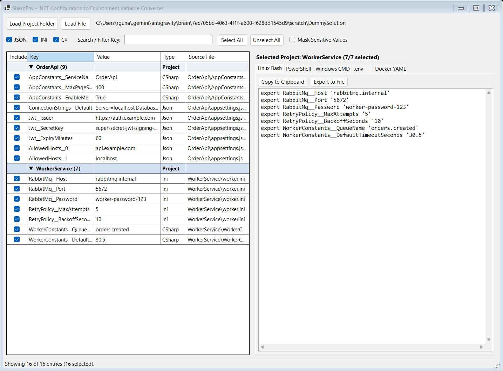
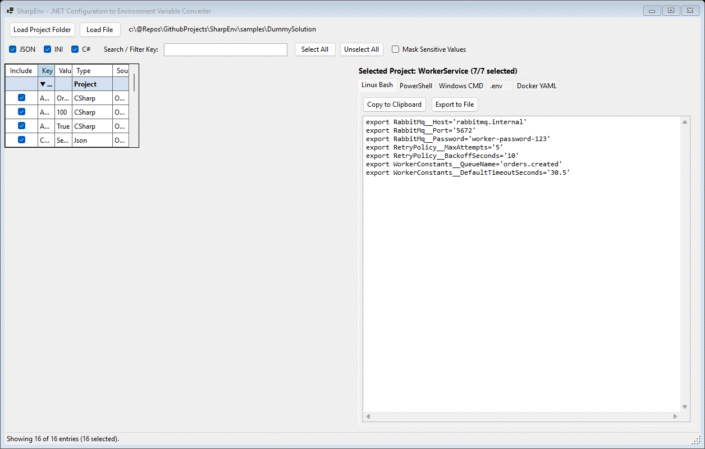

# SharpEnv

**SharpEnv** is a lightweight .NET 10 desktop utility that scans .NET projects and solutions to extract configuration values from **JSON** (`appsettings.json`), **INI** files, and **hardcoded C# constants/static readonly fields** (via Roslyn), and converts them into ready-to-use environment variable formats.



### Live Demo



---

## Features

- **Multi-Source Scanning (`SharpEnv.Core`):**
  - **JSON (`JsonConfigParser`):** Flattens nested objects and arrays into .NET Configuration `__` keys (e.g., `ConnectionStrings__Default`, `AllowedHosts__0`), skipping comments and trailing commas.
  - **INI (`IniConfigParser`):** Parses `[Section]` and `Key=Value` into `Section__Key`, ignoring `;` / `#` comments and stripping surrounding quotes.
  - **C# (`CSharpHardcodedParser`):** Uses Roslyn (`Microsoft.CodeAnalysis.CSharp`) to extract `const` and `static readonly` primitive fields (`string`, `int`, `long`, `bool`, `double`, `decimal`) with literal initializers as `{ClassName}__{FieldName}`.
- **Project Grouping & Per-Project Output:**
  - Automatically groups entries by `.csproj` / `.fsproj` / `.vbproj` project name with expandable/collapsible headers.
  - The right-hand output panel dynamically updates to show only the environment variables for the currently selected project.
- **5 Export Formats:**
  - **Linux Bash:** `export KEY='VALUE'` (safe single-quote escaping)
  - **PowerShell:** `$env:KEY="VALUE"` (escapes `` ` ``, `"`, and `$`)
  - **Windows CMD:** `set KEY=VALUE`
  - **`.env`:** `KEY="VALUE"` (escapes `\`, `"`, and newlines)
  - **Docker YAML:** `      - KEY=VALUE`
- **Interactive Desktop UI (`SharpEnv.Desktop`):**
  - Drag-and-drop folders or files directly onto the window, or pass a path via CLI arguments.
  - Filter by source type (`JSON`, `INI`, `C#`) and search by key name.
  - **Mask Sensitive Values** (`Password`, `Secret`, `Key`, `Token`, `ConnectionString`) in the grid while preserving real values on copy/export.
  - Inline editing for `Key`, `Value`, and `Include` checkboxes with instant live preview.
  - One-click **Copy to Clipboard** and **Export to File**.

---

## Prerequisites

- [.NET 10 SDK](https://dotnet.microsoft.com/) (Windows, for `net10.0-windows` WinForms support)

---

## Getting Started

### Build & Run

```powershell
# Restore and build the solution
dotnet build SharpEnv.sln -c Release

# Run the desktop application
dotnet run --project SharpEnv.Desktop/SharpEnv.Desktop.csproj
```

You can also pass a project or solution folder directly as a command-line argument:

```powershell
dotnet run --project SharpEnv.Desktop/SharpEnv.Desktop.csproj -- "samples/DummySolution"
```

---

## How to Use

1. **Load a Project or File:**
   - Click **Load Project Folder** to scan an entire `.NET` solution/project directory (automatically skips `bin`, `obj`, `.git`, `.vs`, `.idea`, `node_modules`, and `packages`).
   - Click **Load File** to inspect one or more individual `.json`, `.ini`, or `.cs` files.
   - Or **drag and drop** any folder or config file directly onto the SharpEnv window.
2. **Navigate by Project:**
   - Entries are grouped under collapsible headers (e.g., `▼ OrderApi (7)`).
   - Click a group header to **expand** or **collapse** its entries.
   - Click any group header or row to switch the right-hand output panel to that project.
3. **Filter, Search & Mask:**
   - Toggle **JSON**, **INI**, or **C#** checkboxes to show/hide specific source types.
   - Use **Search / Filter Key** to narrow down keys in real time.
   - Enable **Mask Sensitive Values** to hide sensitive values (`Password`, `Secret`, `Key`, `Token`, `ConnectionString`) in the grid during screen sharing—exports still use the actual values.
4. **Customize & Export:**
   - Uncheck **Include** on any row you want to exclude, or click **Select All** / **Unselect All**.
   - Double-click any **Key** or **Value** cell to edit it inline; all 5 output tabs update immediately.
   - Switch to your desired tab (**Linux Bash**, **PowerShell**, **Windows CMD**, **.env**, or **Docker YAML**) and click **Copy to Clipboard** or **Export to File**.

---

## Solution Structure

```text
SharpEnv/
├── SharpEnv.sln
├── docs/
│   └── screenshot.png
├── SharpEnv.Core/
│   ├── Formatters/       # Bash, PowerShell, CMD, .env, Docker YAML formatters
│   ├── Models/           # ConfigEntry, ConfigSourceType, ScanOptions
│   ├── Parsers/          # JsonConfigParser, IniConfigParser, CSharpHardcodedParser
│   └── Services/         # ProjectScannerService
└── SharpEnv.Desktop/
    ├── MainForm.cs       # WinForms UI logic, grouping, masking, async scan
    ├── MainForm.Designer.cs
    └── Program.cs        # Explicit parser & formatter registration (no reflection)
```
